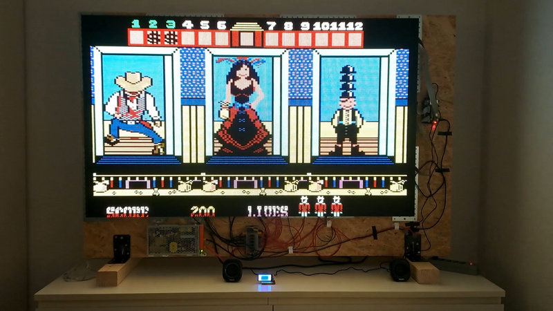
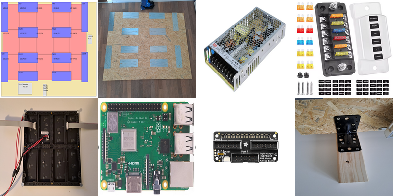
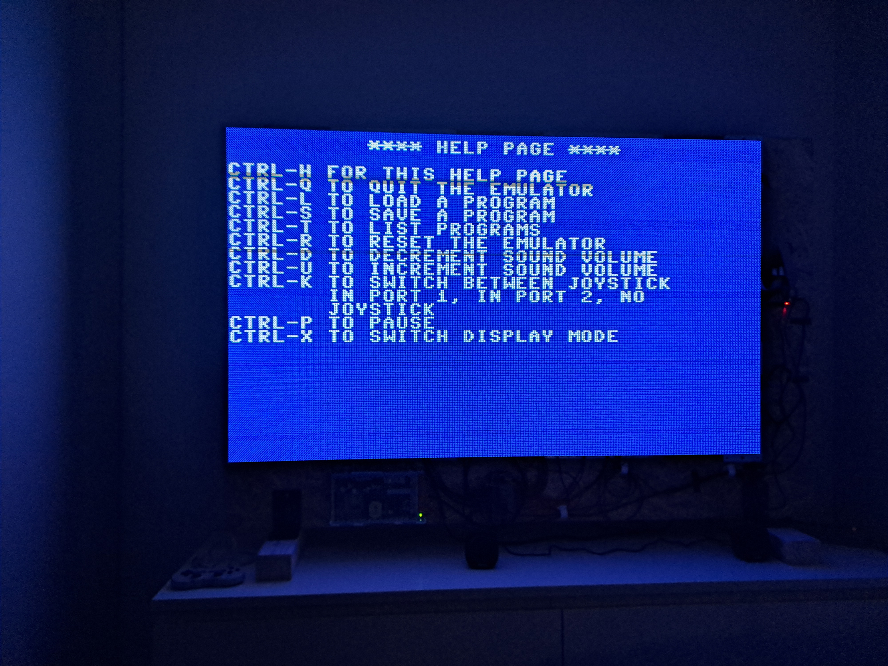

# C64 emulator running on an LED matrix wall

The emulator can run on a Raspberry Pi using an Adafruit Triple LED Matrix Bonnet (or compatible HUB75 adapter)
to drive up to 3 parallel chains of LED matrix panels.
The LED matrix wall consists of 5x3 panels, each with a resolution of 64x64 pixels, resulting in a total resolution of 320x192 pixels.
The C64's vertical resolution is not quite reached. Consequently, 4 lines at the top and 4 lines at the bottom are cropped by default.

[](https://youtu.be/iq0egGeS0xY)

The visual effect you see in the video above (and also in the following images) is known as scanline banding or the flicker effect.
It occurs because the LED wall refreshes at an extremely high speed (pulse-width modulation), which clashes
with the line-by-line image capture (rolling shutter) of smartphone cameras. To the naked eye, however,
the display is completely smooth and free of any lines or artifacts.

Furthermore, the colors are significantly more intense in reality than in the video.


## Hardware

I used the following components to build the LED matrix wall:

- Wooden wall (OSB-3 board, V100, unsanded); 145cm x 95cm
- Raspberry Pi 3 Model B+
- Adafruit Triple LED Matrix Bonnet
- 15 P4 LED matrix panels:
  Each of the 15 panels (LED type SMD212, HUB75 interface) measures 256mm x 256mm and has a resolution of 64 x 64 pixels.
  The size of the arranged LED matrix panels is therefore 128cm x 76.8cm.
- LED display ribbon cables (HUB75, 16-pin): 2 x 40cm and 13 x 16cm
- 8 power cables for the LED matrix panels (each with 2 connections)
- Power supply unit for the entire system: MeanWell RSP-200-5 (5V / 40A / 200W)
- DaierTek 6-way fuse box including 4 blade fuses 15A (for the panels) and 1 blade fuse 5A (for the Raspberry Pi)
- 12 flat metal connectors (300mm x 100mm)
- 60 M3 1317 magnetic screws for attaching the LED matrix panels to the wall (via the flat metal connectors)
- Metal angle brackets for mounting the power supply unit onto the LED matrix wall (must not be mounted directly onto the wood!)
- Support structure for the wooden wall: timber beams and angle connectors
- Cables, screws, cable lugs




## Installation

### 1. Setup Raspberry Pi

You need to enable SSH when installing the operating system via Raspberry Pi Imager.
All of the following steps assume that you are connected to the Raspberry Pi via SSH.
A graphical user interface is not required for the LED matrix display (the 'Lite' version of Raspberry Pi OS is sufficient).

#### System tweaks for stable display

After installing the operating system, the system needs some tuning to ensure the display runs without flickering.
Add the following to `/boot/firmware/cmdline.txt` (or `/boot/cmdline.txt` on older systems):

```
sudo sed -i 's/$/ isolcpus=3/' /boot/firmware/cmdline.txt
sudo reboot
```

This isolates CPU core 3 for the matrix refresh task.

The on-board sound hardware shares timing resources with the LED matrix and may cause flickering. Deactivate it with:

```bash
echo "blacklist snd_bcm2835" | sudo tee /etc/modprobe.d/blacklist-rgb-matrix.conf
sudo update-initramfs -u
sudo reboot
```

If you need audio output, use a USB sound dongle instead (has its own timing hardware, no conflict with the matrix).

To significantly reduce background disk writes to the SD card, optimize the file system with noatime.
However, this should already be set up this way by default (see /etc/fstab).

#### Audio Output using an USB Sound Adapter

Since the on-board sound driver (`snd_bcm2835`) is blacklisted to prevent display flickering,
audio output must be routed through an external USB sound card (e.g. Ugreen USB External Stereo Sound Adapter).

In my case, the USB sound stick was detected without any further configuration.
If you encounter any problems, the following guide may be of help:

Verify that ALSA detects the device:
```bash
aplay -l
```

Look for your USB sound device name (e.g., card 1: Audio [KT USB Audio]).

Set the USB sound adapter as the default ALSA playback and control device by creating or editing ~/.asoundrc:
```bash
nano ~/.asoundrc
```

Add the following configuration (using the device name "Audio" ensures it works reliably regardless of card index changes):
```plaintext
pcm.!default {
    type hw
    card "Audio"
}

ctl.!default {
    type hw
    card "Audio"
}
```

Test the audio output to confirm it is working:
```bash
speaker-test -c 2 -twav
```

Adjust volume and un-mute channels if necessary:
```bash
alsamixer
```

Save your volume settings permanently:
```bash
sudo alsactl store
```

#### Install additional packages

First, update the local package database
```bash
sudo apt update
```

Next you need to install the packages libsdl2-dev and git:
```bash
sudo apt install libsdl2-dev
sudo apt install git
```

### 2. Install the rpi-rgb-led-matrix library

Henner Zeller’s rpi-rgb-led-matrix is ​​the most popular and powerful C++ library for controlling
HUB75 RGB LED matrix panels via the GPIO pins of a Raspberry Pi.
The library also supports the Adafruit Triple LED Matrix Bonnet.
```bash
git clone https://github.com/hzeller/rpi-rgb-led-matrix.git
cd rpi-rgb-led-matrix
make -j4
```

### 3. Install the C64 emulator

```bash
git clone https://github.com/retroelec/T-HMI-C64.git
cd T-HMI-C64
make c64rpiled
```

### 4. Bluetooth joystick

#### Prerequisites

- You may have to unblock bluetooth:
```bash
sudo rfkill unblock bluetooth
```

#### Pairing 8BitDo SN30 Pro Bluetooth gamepad

The gamepad must be activated before you start the emulator.
You must pair the gamepad the first time before you can use it.

Gamepad:

- switch off controller
- press start + X, two left LEDs should blink
- press pair button until the LEDs light up alternately

Raspberry Pi:

- disable ertm immediately: echo "1" | sudo tee /sys/module/bluetooth/parameters/disable_ertm
- permanently disable ertm: echo "options bluetooth disable_ertm=1" | sudo tee /etc/modprobe.d/bluetooth-ertm.conf
- start bluetooth shell  
  sudo bluetoothctl
- in the bluetooth shell type  
  scan on
- wait for the gamepad to appear in the log, note MAC address (E4:17:D8:XX:XX:XX)
- go back to the shell and type the following commands (pairing & trust)  
pair E4:17:D8:XX:XX:XX  
trust E4:17:D8:XX:XX:XX  
connect E4:17:D8:XX:XX:XX

The next time the Raspberry Pi starts up, the connection between the gamepad and the Pi can be initiated by pressing Start + X.


## Usage

You first have to connect to the Raspberry Pi via SSH.
Create a subdirectory c64prgs in the directory containing the executable (T-HMI-C64) and then
copy the c64 rom files (.prg) to this directory.

The emulator requires root permissions for GPIO access. Start it with

```bash
sudo ./c64rpiled
```
The emulator reads keyboard input from stdin (raw mode). This allows you to control the C64 emulator directly from your SSH terminal.
Control commands are sent by pressing Ctrl + the corresponding key.

Ctrl+h displays the following help page within the emulator itself:



Ctrl-x cycles through the display modes:  

- Mode 0 (default): The top 4 rows and the bottom 4 rows are not displayed
- Mode 1: The last 8 lines are not displayed
- Mode 2: The first 8 lines are not displayed

